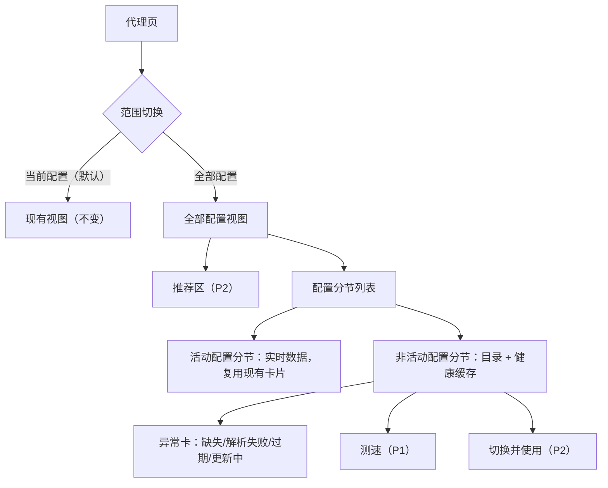
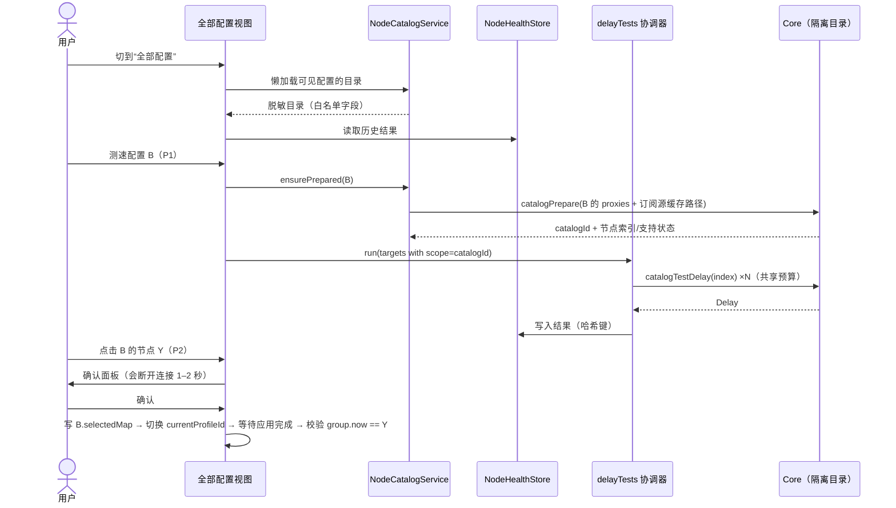
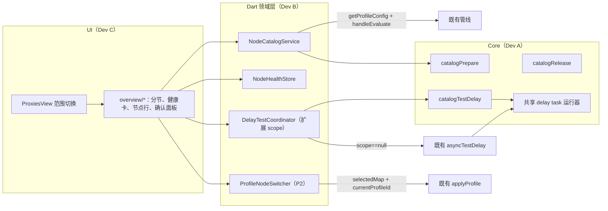
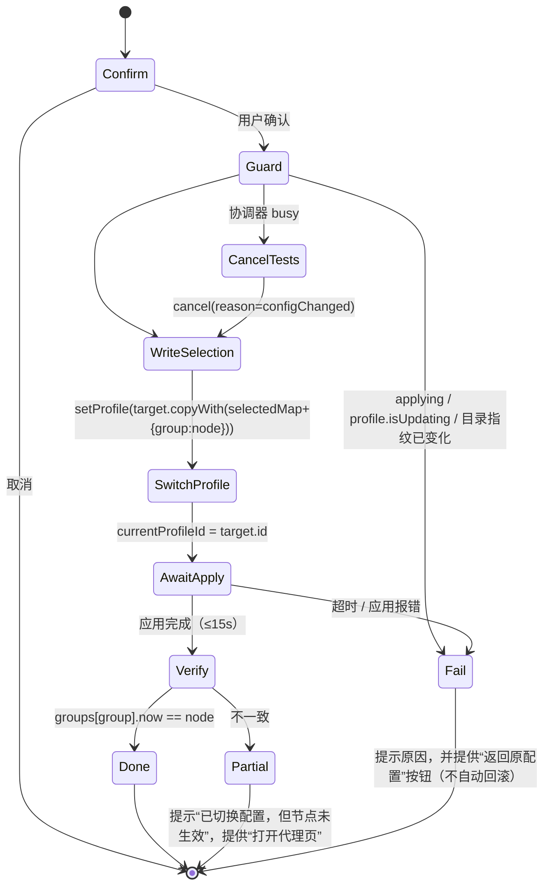

# 跨配置节点总览（Cross-Profile Node Overview）工程书

| 项 | 内容 |
|---|---|
| 文档版本 | v1.0（2026-10-15） |
| 基线 | `development@2074cce2900a0159e75833fcc19ae930dd17f6a5`（与 `freedomcloud/development` 0/0） |
| 状态 | P0 源码已本地提交 `c8fa0a3`，完成本地自动化验证；FR-4 接管历史限制与真机 NOT RUN 见下方补记；P1/P2 未实施、未推送 |
| 负责人（评审/Git 写操作） | 技术负责人（本书作者） |
| 实施者 | Dev A（Core/Go）、Dev B（Dart 领域层）、Dev C（UI） |
| 授权边界 | 只做本地开发与本地提交；推送、PR、合并、发布、运行候选包、操作现役代理/TUN/服务，均需另行授权（见 `AGENTS.md`） |

---

### P0 实施补记（2026-10-15）

本书保留原设计基线；实际开工为 `development@c7166fe`，相对 `2074cce` 仅增加本书与台账。源码提交、测试计数和已知缺口以 [开发台账](../development-status.md) 与 [P0 测试记录](../testing/node-overview-p0-2026-10-15.md) 为准。

- P0 目录、宽窄总览、搜索/排序/筛选、脱敏历史、异常提示及开关回退已实现。目录构建只读，不调用配置应用、订阅下载或 TUN/服务操作；非活动 provider 叶子仍属于 P1。
- FR-4 只保存显式测速中可绑定到已应用运行快照的结果；无请求归属的 Core 广播只保留实时显示。新 UI 接管已有 Core 时没有可信快照，旧历史可读、新结果暂不记录，不能称完整 FR-4 验收。没有通过 setup/重启补建快照；完整接管记录需后续只读运行身份契约。
- P0 不改 Core/Agent/Helper；本轮只获准本地实现、测试和提交，不推送、不启动候选包、不影响现役代理/TUN。真实窗口、性能及完整运行链验收仍为 NOT RUN。

## 1. 背景与问题

当前产品中，节点（proxy）挂在“配置（profile）”下面。Mihomo 内核同一时间只加载一个配置，代理页只能展示**当前配置**的节点及延迟。用户想比较多个订阅的节点，必须反复“切配置 → 进代理页 → 测速”。每次切配置都会重载内核、断开现有连接，切走后测速结果也会被清空（[handleChangeProfile](file:///e:/CodeWorkstation/FlClashX/lib/controller.dart#L1096-L1097) 会清空 `delayDataSourceProvider`）。

用户关心的是“现在哪条线路能用、最快”，以及“哪个订阅整体坏了”，而不是“配置”这个容器。

## 2. 目标与非目标

### 2.1 目标
- G1：在代理页一个视图内，按配置分组浏览**所有配置**的节点。
- G2：展示每个配置的健康摘要（可用数/总数、中位延迟、最近测试时间、异常原因）。
- G3：可以对非活动配置的节点测速，**不切换现役配置、不影响现有连接、不触碰 TUN/权限**。
- G4：一次操作完成“切到配置 B 并使用节点 Y”，并在执行前明确告知代价。
- G5：分阶段交付（P0 → P1 → P2），每阶段都能独立预览、独立回退。

### 2.2 非目标
- 不改变配置/订阅的存储格式，不改变订阅自动更新策略，测速前也不自动更新订阅。
- 不同时运行多个配置（不做多配置并行代理、负载均衡）。
- 不做跨配置“自动选优并切换”（只推荐，切换必须由用户确认）。
- 不改购买、兑换、账号同步等任何功能。
- 不支持代理组（select/url-test/fallback/load-balance）在非活动配置中的“当前选择”展示。

## 3. 术语

| 术语 | 含义 |
|---|---|
| 活动配置（Active profile） | `currentProfileId` 指向、已由内核加载的配置 |
| 非活动配置（Inactive profile） | 已保存但未加载的配置 |
| 目录（Catalog） | 某配置所有叶子节点的**脱敏摘要**列表（不含凭据） |
| 叶子节点（Leaf node） | `proxies` 或 proxy-provider 中的具体节点，不含代理组 |
| 隔离测速（Isolated test） | 内核用独立解析出的出站适配器测速，不注册进 tunnel、不参与路由 |
| NodeKey | 节点稳定标识，见 §8.1 |
| 健康缓存（Health store） | 跨会话保存的测速结果，只存哈希键与数值 |

## 4. 需求

### 4.1 功能需求

| ID | 需求 | 阶段 |
|---|---|---|
| FR-1 | 代理页提供 `当前配置 / 全部配置` 切换；配置数 < 2 时隐藏切换，行为与现状完全一致 | P0 |
| FR-2 | 全部配置视图按配置分节展示叶子节点：名称、协议类型、来源（内联/订阅源名）、延迟及测试时间 | P0 |
| FR-3 | 活动配置分节复用现有实时数据与现有选择交互，行为与“当前配置”视图一致 | P0 |
| FR-4 | 非活动配置显示“上次处于活动状态时的测速结果 + 时间”；没有记录时显示“未测” | P0 |
| FR-5 | 配置健康摘要：可用数/已测数/总数、中位延迟、最近测试时间、延迟分布色带 | P0 |
| FR-6 | 配置异常卡：文件缺失、解析失败、订阅过期（`subscriptionInfo.expire`）、正在更新；提供已有的“更新订阅”入口 | P0 |
| FR-7 | 跨配置搜索（复用 `proxiesQueryProvider`）、按延迟/名称排序、“仅显示可用”筛选 | P0 |
| FR-8 | 非活动配置节点可单个、按配置、全部测速；进度可见、可取消 | P1 |
| FR-9 | 订阅源（proxy-provider）节点：读取本地已缓存的订阅源文件后展示和测速；**绝不发起网络下载** | P1 |
| FR-10 | 点击非活动配置的节点 → 确认面板 → 原子完成“切配置 + 选节点” → 校验生效 | P2 |
| FR-11 | 推荐区：在新鲜（≤10 分钟）且成功的结果中取最优 3 个 | P2 |
| FR-12 | 重复节点标注：不同配置中端点相同（类型+服务器+端口）的节点，标“另见于 X” | P2 |

### 4.2 非功能需求

| ID | 需求 |
|---|---|
| NFR-1 安全 | 凭据（password/uuid/private-key/token 等）不能进入 Dart 状态模型、持久化文件、日志、测试快照；目录模型采用**字段白名单** |
| NFR-2 隔离 | 非活动配置的任何操作都不得调用 `setupConfig/updateConfig`，不得改变 TUN/系统代理/服务状态，不得申请权限 |
| NFR-3 性能 | 进入全部配置视图 ≤300ms 出骨架；单配置目录构建（≤2000 节点）≤1.5s（Windows 参考机）；列表滚动无明显掉帧（懒加载 Sliver） |
| NFR-4 资源 | 内核侧隔离目录最多同时 3 个，空闲 10 分钟回收；每个目录最多 2000 节点；所有适配器按生命周期关闭 |
| NFR-5 预算 | 测速共享现有 `delayTests` 协调器与内核准入（`maxDelayTasks=150`）；不新增并行预算 |
| NFR-6 兼容 | Windows/macOS/Linux/Android 共用同一套 Core action；不改变现有 action 的语义和返回格式 |
| NFR-7 可回退 | 入口由开关 `nodeOverviewEnabled` 控制；关闭后 UI 回到现状，健康缓存文件删除后不影响任何功能 |
| NFR-8 可观测 | 只记录计数和原因码（例如 `catalog.prepare nodes=120 unsupported=3 ms=420`），不记录节点名、服务器、URL |

## 5. 概念设计

### 5.1 用户心智模型
“我有几条线路来源（订阅），每个来源里有若干节点；我要看全部线路的状态，挑一条用。”节点是主体，配置是**分组与来源信息**。

### 5.2 信息架构



### 5.3 布局
- **宽窗（≥ 900 逻辑像素）**：双栏。左栏 280–320px 为配置健康卡列表（首项“全部”）；右栏为节点列表，按配置分节，可折叠。
- **窄窗 / 移动端**：单栏手风琴；配置卡展开后就地显示节点。
- 断点复用现有 `isMobileViewProvider`/视图宽度工具，不另造断点体系。

### 5.4 关键交互流程



## 6. 现状与约束（代码事实）

| 事实 | 位置 | 对设计的影响 |
|---|---|---|
| 内核测速只在已加载配置里按名称找节点 | [handleAsyncTestDelay](file:///e:/CodeWorkstation/FlClashX/core/delay_tasks.go#L69-L163)，`lookupDelayProxy` | 非活动配置测速必须新增内核接口 |
| 显式请求（带 request-id）测速成功时不发 `DelayMessage`；不带 request-id 时会广播 | delay_tasks.go L157-161 | 目录测速**必须**带 request-id，**禁止**广播，否则会用节点名污染现役延迟 |
| 内核准入 150（50 执行 + 100 排队），超出返回 `overloaded` | delay_tasks.go L16 | 目录测速与现役测速共享该预算 |
| 现役配置变化、会话关闭、UI 不活跃时取消全部测速任务 | `common.go` L488、`hub.go` L236/258/521、`server.go` | 目录测速同样会被取消，UI 需如实显示原因并允许重试 |
| Dart 协调器按 `(name,url)` 去重，批次超时 30s，并发 10 | [DelayTestCoordinator](file:///e:/CodeWorkstation/FlClashX/lib/common/delay_test_coordinator.dart#L44-L112) | 必须增加 `scope` 维度去重；大批量需要可配置的批次超时 |
| 测速结果写入按名称索引的 `delayDataSourceProvider`，切换配置时清空 | [delay_tests.dart](file:///e:/CodeWorkstation/FlClashX/lib/common/delay_tests.dart)、controller L1097 | 非活动配置结果必须写入独立存储 |
| 配置 → 运行配置的管线：`getProfileConfig`（内核解析文件）→ `handleEvaluate`（全局 JS 脚本）→ `patchRawConfig` | [state.dart](file:///e:/CodeWorkstation/FlClashX/lib/state.dart#L539-L854) | 目录必须走 `getProfileConfig + handleEvaluate`，否则与实际运行的节点不一致 |
| 订阅源缓存路径按配置隔离：`profiles/providers/<profileId>/proxies/<md5(url)>` | [getProvidersFilePath](file:///e:/CodeWorkstation/FlClashX/lib/common/path.dart#L125-L138) | P1 可以只读本地缓存，不需要联网 |
| 选择状态保存在 `Profile.selectedMap`，`setupConfig` 加载后由 `selectRuntimeGroups(params.SelectedMap)` 应用 | [profile.dart](file:///e:/CodeWorkstation/FlClashX/lib/models/profile.dart#L64)、`core/common.go` L453 | 跨配置切换 = 先写目标配置的 `selectedMap`，再切 `currentProfileId`，不需要额外调用 changeProxy |
| 修改 `currentProfileId` → `needSetupProvider` → `handleChangeProfile` → `applyProfile` | [clash_manager.dart](file:///e:/CodeWorkstation/FlClashX/lib/manager/clash_manager.dart#L46-L50)、controller L459-462 | 切换时不能再显式调用 apply（会重复 setup），需要“等待下一次应用完成”的钩子 |
| 删除配置时调用 `clearEffect(profileId)` | controller L465-479、L2039 | 在这里清理目录缓存与健康缓存 |
| 延迟颜色统一来自 `utils.getDelayColor` | [utils.dart](file:///e:/CodeWorkstation/FlClashX/lib/common/utils.dart#L14) | 新 UI 复用，保持一致 |

## 7. 架构总览



原则：**现役链路零修改语义**。新增能力都走新方法；对既有代码只做两处小的可测试重构：`delay_tasks.go` 抽出共享运行器，协调器增加 `scope`。

## 8. 详细设计

### 8.1 数据模型（Dart，`lib/models/node_catalog.dart`，freezed）

```dart
enum CatalogNodeSource { inline, provider }

enum CatalogUnsupportedReason {
  none, chainUnsupported /* dialer-proxy */, typeUnsupported /* wireguard 等重型 */,
  parseFailed, providerNotCached, strictModeUnsupported,
}

@freezed
class CatalogNode with _$CatalogNode {
  const factory CatalogNode({
    required String identityKey,   // 配置内唯一，用作健康缓存键
    required String endpointKey,   // 跨配置去重键
    required String name,          // 仅内存展示，不持久化
    required String type,          // ss/vmess/vless/trojan/hysteria2/...
    required CatalogNodeSource source,
    String? providerName,
    int? coreIndex,                // P1：catalogPrepare 返回的索引
    @Default(<String>[]) List<String> selectGroups, // 直接包含该节点的 select 组（P2 用）
    @Default(CatalogUnsupportedReason.none) CatalogUnsupportedReason unsupported,
  }) = _CatalogNode;
}

enum ProfileCatalogStatus { ready, loading, fileMissing, parseFailed, updating }

@freezed
class ProfileCatalog with _$ProfileCatalog {
  const factory ProfileCatalog({
    required String profileId,
    required String fingerprint,       // 见 8.2
    required ProfileCatalogStatus status,
    @Default(<CatalogNode>[]) List<CatalogNode> nodes,
    @Default(<String, int>{}) Map<String, int> providerNodeCounts,
    String? errorSummary,              // 已脱敏，≤120 字符
    String? coreCatalogId,             // P1
  }) = _ProfileCatalog;
}
```

**NodeKey 规则（v1，写死并加单测）：**
- `identityKey = hex(sha256("v1|" + profileId + "|" + source + "|" + (providerName ?? "") + "|" + type + "|" + lower(server) + "|" + port + "|" + name))[0..32]`
- `endpointKey = hex(sha256("v1|" + type + "|" + lower(server) + "|" + port))[0..32]`
- **禁止**把 password/uuid/sni/证书等放进哈希输入；**禁止**用节点名单独做键。
- `server`/`port` 只参与哈希计算，**不作为模型字段保存**（UI 不展示服务器地址，以减少截图泄露风险）。

**字段白名单：** 从原始 map 只读取 `name, type, server, port, dialer-proxy(仅判断是否存在)`。其他字段一律不读、不拷贝。原始 map 在函数作用域内用完即丢，不得挂到任何 Provider/State 上。

### 8.2 目录服务 `NodeCatalogService`（`lib/common/node_catalog_service.dart`）

职责：为某个 profile 构建 `ProfileCatalog`，负责缓存与失效。

```text
Future<ProfileCatalog> load(Profile profile)
  1. 文件不存在（profile.check()==false） → status=fileMissing
  2. profile.isUpdating → 返回旧缓存并标 updating；没有缓存则 status=updating
  3. fingerprint = "${lastModifiedMicros}|${fileSize}|${scriptId}|${sha256(script.content) 前16位}"
     命中内存 LRU（容量 8）则直接返回
  4. raw = await globalState.getProfileConfig(id)      // 内核解析，与运行一致
     raw = await globalState.handleEvaluate(raw)       // 与运行一致（全局脚本）
     失败 → status=parseFailed, errorSummary=sanitize(e)
  5. 解析 raw["proxies"] 与 raw["proxy-groups"]（只取 name/type/proxies/use），按白名单生成 CatalogNode
     - 叶子节点 = proxies 中 type 不属于 {direct, reject, reject-drop, pass, dns, compatible} 的条目
     - selectGroups：type=="select" 且 proxies 列表直接包含该节点名的组名，保持 proxy-groups 原顺序
     - 订阅源节点：P0 只统计 provider 名称，节点数显示“激活后可见”；P1 由 catalogPrepare 返回
  6. 放入 LRU；串行化：同一 profileId 的并发 load 合并为同一个 Future
```

- **并发限制**：全局最多 2 个 profile 同时构建（`getConfig` IPC 和 QuickJS 都很重）。
- **懒加载**：只有分节进入视口或展开时才构建；左栏摘要只用已构建的目录和健康缓存，未构建时显示“—”。
- **活动配置**：目录照常构建（用于 NodeKey 映射与健康快照），但节点展示与交互走实时 `currentGroupsStateProvider`。
- **失效**：监听 `profilesProvider`，某个 profile 的 `lastUpdateDate`/`url`/`isUpdating` 变化，或全局脚本变化时，清掉对应缓存；`clearEffect(id)` 时清除该 profile 的缓存。
- **sanitize(e)**：取第一行，去掉 `http(s)://…`，截断到 120 字符。原始错误只能进入现有调试日志，并遵守现有日志脱敏规则。

### 8.3 健康缓存 `NodeHealthStore`（`lib/common/node_health_store.dart`）

- 存储文件：`<homeDir>/node_health_v1.json`。原子写（临时文件 + rename），2s 防抖。
- 结构（**不含节点名、服务器、URL 明文**）：

```json
{ "version": 1,
  "entries": { "<profileId>": { "<identityKey>": { "d": 183, "t": 1760500000000, "r": null, "u": "<sha256(testUrl)前16位>" } } } }
```

- `d`：延迟毫秒；失败时为 -1，并在 `r` 写原因码（`testFailed/deadlineExceeded/cancelled/...`）。
- 限额：总条目 ≤ 5000，超出按 `t` 淘汰最旧；`t` 超过 7 天的条目在加载时丢弃。
- 文件损坏或版本未知：备份为 `.corrupt-<ts>`（最多保留 1 个），以空数据启动，不弹错误。
- 写入来源：
  1. **活动配置实时结果**：监听 `delayDataSourceProvider`，通过当前目录的 `name → identityKey` 映射写入。每条结果到达即写，不依赖切换前快照（切换时数据源会被清空）。映射不到的名称（代理组）忽略。
  2. **目录测速结果**（P1）：协调器回调直接写入。
- 读取：UI 只展示 `u` 等于当前有效测试地址（`appSetting.testUrl` 解析值）的结果；有组级 testUrl 的情况在目录视图中不区分（写进已知限制）。
- 新鲜度：`now - t > 10min` 显示为“可能过时”（灰色并带时间）。
- 删除配置：`clearEffect(id)` 时调用 `removeProfile(id)`。

### 8.4 测速链路扩展

#### 8.4.1 协调器（`lib/common/delay_test_coordinator.dart`）

```dart
class DelayTestTarget {
  const DelayTestTarget(this.name, this.url, {this.scope, this.nodeIndex});
  final String name;      // live: 代理名；catalog: identityKey
  final String url;
  final String? scope;    // null = 现役；非空 = coreCatalogId
  final int? nodeIndex;   // catalog 必填
  (String, String, String) get key => (scope ?? '', name, url);
}

Future<DelayBatchResult> run(Iterable<DelayTestTarget> targets, {Duration? batchTimeout});
```

- 仍然是**单例、单批次**：目录测速运行时，现役“测全部”返回 `busy`（现有提示文案），反之亦然。这是有意保持预算统一。
- 目录批次超时：`clamp(ceil(n / concurrency) × requestTimeout × 1.5, 30s, 10min)`，由调用方传入；现役调用不传，保持 30s。
- 单批目标上限：现有 `maxTargets=10000` 不变；目录“全部测速”在 UI 层按配置分批串行提交，每批 ≤ 2000。
- `configChanged/sessionClosed/uiInactive/transportFailure` 取消整批的现有语义不变。

#### 8.4.2 路由（`lib/common/delay_tests.dart`）

```dart
test: (t, id, timeout) => t.scope == null
    ? clashCore.getDelayResult(t.url, t.name, requestId: id, timeout: timeout)
    : clashCore.catalogTestDelay(t.scope!, t.nodeIndex!, t.url, requestId: id, timeout: timeout),
onStarted: (t) => t.scope == null ? <现有 setDelay(value: 0)> : nodeHealthStore.markPending(t),
onResult:  (t, r) => t.scope == null ? <现有 setDelay> : nodeHealthStore.put(t, r),
```

`nodeHealthStore` 需要从 `scope` 反查 profileId：由 `NodeCatalogService` 维护 `catalogId → profileId` 映射。

### 8.5 Core 接口（Dev A，`core/catalog.go`）

新增三个 action，在 `constant.go` 增加常量，在 `action.go` 分发。所有平台共用 `handleAction`，Windows（Helper 拉起的 Core 进程）、Android（进程内库）等无需单独适配。Dart 侧在 `lib/clash/interface.dart` 和 `lib/clash/core.dart` 增加对应方法。

#### 8.5.1 `catalogPrepare`

请求：
```json
{ "catalog-id": "c-<uuid>",
  "proxies": [ { …经 handleEvaluate 后的原始节点 map… } ],
  "providers": [ { "name": "sub1", "config": { …proxy-provider 配置（去掉 url）… }, "path": "<绝对路径>" } ] }
```
响应：
```json
{ "catalog-id": "c-…",
  "nodes": [ { "index": 0, "name": "HK 01", "type": "vless", "source": "inline",
               "provider": null, "server": "a.example", "port": 443,
               "supported": true, "reason": "" } ],
  "providers": [ { "name": "sub1", "status": "ok|notCached|parseFailed", "count": 42 } ] }
```

规则：
1. `catalog-id` 匹配 `^c-[A-Za-z0-9-]{8,64}$`，否则返回 `invalidParameters`。
2. 节点总数（内联 + 订阅源）> 2000 → `tooManyNodes`，不做部分解析。
3. 严格模式：`activeStrictIngress != nil || macStrictIngressIntent != nil` 时返回 `strictModeUnsupported`。严格模式的出站策略约束未经单独评审前，不开放隔离测速。
4. 订阅源 `path`：必须通过 `constant.Path.IsSafePath`，并且规范化后位于 `<home>/profiles/providers/` 之下、第三级目录为 `proxies`。不满足 → 整个请求 `invalidParameters`。文件不存在 → 该源 `notCached`。**只读本地文件，绝不创建 vehicle、绝不联网。**
5. 订阅源内容解析（**先做技术预研 S1**）：优先调用 Mihomo 已导出的订阅源解析与过滤函数（需同时覆盖 YAML `proxies:`、URI/Base64 列表，以及 `filter / exclude-filter / exclude-type / override`）。如果固定版本没有可复用的导出函数：P1 降级为 `notSupportedInPreview`，**不要**手写一套可能和上游不一致的过滤逻辑，也**不要**为此新增 overlay 补丁（需另行评审）。
6. 每个节点用 `adapter.ParseProxy(mapping)` 构建适配器，不注册进 `tunnel`，不启动任何监听：
   - 含 `dialer-proxy` → `supported=false, reason=chainUnsupported`（不解析链）；
   - `type ∈ {wireguard, amneziawg}` 等每实例自带用户态网络栈的重型协议 → `typeUnsupported`（P1 不支持）；
   - 解析错误 → `parseFailed`，错误文本**不回传**（可能包含配置片段），只记录计数。
7. 响应中的 `server/port` 只用于 Dart 计算 NodeKey；Dart 不得保存或展示它们。
8. 存储：`map[catalogID]*catalog{ proxies []C.Proxy; lastUsed time.Time }`，并有独立的 `catalogMu`。**不得持有 `runLock`**（避免与 setupConfig 相互阻塞）。容量 3，按 LRU 淘汰；空闲 10 分钟淘汰（惰性 + 每分钟清扫一次）。同 id 重复 prepare 时先释放旧的再替换。
9. 淘汰/释放时：对实现了 `Close() error`（或 `io.Closer`）的适配器调用关闭；如果有测速正在使用该目录，等它结束或被取消后再关闭（引用计数）。
10. 会话关闭（`server.go` 的 sessionClosed 路径）、`handleShutdown` 时释放所有目录。

#### 8.5.2 `catalogTestDelay`

请求：`{ "request-id": "...", "catalog-id": "...", "index": 3, "url": "...", "timeout": 5000 }`（`request-id` **必填**）。
响应：与现有 `Delay` 结构一致：`{ "name": "<index>", "url": "...", "value": 183, "reason": "" }`。

实现：把 `handleAsyncTestDelay` 中“准入 → 注册 delayTasks → 信号量 → 查找 → URLTest → 统一完成”抽成
`runDelayTask(params TestDelayParams, lookup func(ctx) (C.Proxy, string /*reason*/), fn func(string), broadcast bool)`。
- 现役：`lookup = lookupDelayProxy(name)`（在 `runLock` 内），`broadcast = params.RequestID == ""`，**行为保持不变**；
- 目录：`lookup` 在 `catalogMu` 内取适配器并增加引用计数；`broadcast = false`（**永远不发 DelayMessage**）。目录不存在 → `catalogNotFound`；index 越界 → `invalidParameters`；节点不支持 → 对应 reason。
- 共享 `delayTaskSlots`、`testDelaySem`、`delayTasks` 注册表 → 现有 `cancelTestDelay(id)` 与 `cancelAllDelayTasks` 自动生效。

#### 8.5.3 `catalogRelease`

请求：`{ "catalog-id": "..." }`；幂等，返回 `true`。Dart 在离开全部配置视图 30s 后、profile 更新/删除时、目录指纹变化时调用。

#### 8.5.4 新增原因码

| reason | 含义 | UI 文案（zh） |
|---|---|---|
| `catalogNotFound` | 目录已被回收 | 自动重新准备并重试一次，仍失败则显示“请重试” |
| `tooManyNodes` | 超过 2000 | “节点过多，暂不支持测速” |
| `strictModeUnsupported` | 严格模式中 | “严格模式下不支持测试非当前配置” |
| `chainUnsupported` | dialer-proxy 链 | “链式节点暂不支持单独测速” |
| `typeUnsupported` | 重型协议 | “该协议暂不支持单独测速” |
| `providerNotCached` | 订阅源未缓存 | “订阅源未缓存，激活此配置后可见” |
| `notSupportedInPreview` | 预研降级 | “预览版暂不支持” |

#### 8.5.5 TUN / DNS / 路由说明
- 目录适配器使用与现役节点相同的进程内拨号器（默认接口绑定、路由标记），流量不会进入 tunnel 的规则匹配，也不会出现在连接列表里。
- 节点域名解析使用现役配置的代理服务器解析器，与现役节点一致。
- **必须验证（VM）**：TUN 开启 + auto-route 时，目录测速不会回环进入 TUN，也不会出现在连接列表；TUN 关闭时正常。没有 VM 证据前，本项在报告中记为 NOT RUN。

### 8.6 跨配置切换（P2，`lib/common/profile_node_switcher.dart` + controller 钩子）

#### 8.6.1 目标组选择算法

```text
input: targetProfile, catalog, node, mode
if mode == global: return "GLOBAL"
candidates = node.selectGroups（proxy-groups 原顺序）
if candidates.isEmpty:
    if node.source == provider: 再看 select 组的 `use` 是否包含该 provider 且该组没有 filter/exclude-filter/exclude-type
    仍为空 → 不可切换，提示“该节点只由自动组管理，激活配置后在代理页选择”
if targetProfile.currentGroupName ∈ candidates: return 它
if 候选只有 1 个: return 它
否则弹出选择器（显示组名，默认选中第一个）
```

#### 8.6.2 状态机



- **应用完成钩子**：在 `AppController` 中增加 `_applyGeneration`（单调递增）和 `Future<void> waitForApplyAfter(int generation, Duration timeout)`；`_applyProfile` 结束（成功或失败）时递增并完成等待者，失败时携带错误。切换器**不得**直接调用 `applyProfile()`（会和监听链路重复 setup）。
- 不自动回滚：自动回滚可能造成第二次断连，或在失败配置之间来回切换；只提供一键“返回原配置”（回到原 `currentProfileId`）。
- 切换路径不得调用任何 TUN/系统代理/服务相关方法；TUN 行为完全交给既有 `applyProfile`，遵守“本会话手动关闭后不自动重开、不重复授权”的产品规则。
- 确认面板文案：`切换到「{profile}」并使用「{node}」？当前连接会短暂中断。` 主按钮“切换并使用”，次按钮“取消”。

### 8.7 UI 详细设计（Dev C，`lib/views/proxies/overview/`）

| 文件 | 内容 |
|---|---|
| `overview_view.dart` | 全部配置视图根组件；根据宽度选择双栏/手风琴 |
| `profile_health_card.dart` | 左栏/分节头：名称、“使用中”徽标、`可用 a/b · 中位 x ms · n 分钟前`、分布色带、异常态与动作 |
| `catalog_section.dart` | 单个配置分节（SliverList 懒加载）；活动配置复用现有 `ProxyCard`；非活动配置使用 `CatalogNodeTile` |
| `catalog_node_tile.dart` | 节点行：名称、类型标签、来源标签、延迟（颜色 + **数字/文字**，不只靠颜色）、时间、状态图标 |
| `switch_confirm_sheet.dart` | P2 确认面板 + 组选择器 |
| `recommendation_strip.dart` | P2 推荐区 |
| `overview_toolbar.dart` | 排序、筛选、全部测速/取消（复用 `DelayTestAction`） |

- 范围状态：`proxiesScopeProvider`（内存，默认 `current`，P0 不持久化）。`ProxiesView.build` 中 `scope == all` 时渲染 `OverviewView`，否则保持现有 `switch (proxiesType)`。
- 入口：范围切换放在现有 actions 最前面；`profiles.length < 2` 或 `!nodeOverviewEnabled` 时不渲染。
- 延迟色带：分段占比 = 绿（getDelayColor 绿档）/黄/红/灰（失败）/空（未测），宽 100%、高 4px、圆角。
- 状态全集：加载骨架、空、文件缺失、解析失败、订阅过期、更新中、严格模式不可测、测速中（单节点转圈）、过时（灰）。
- 多语言：在 `arb/` 的 zh_CN、en、ru、ja 中新增键，前缀统一为 `nodeOverview*`（例：`nodeOverviewScopeAll`、`nodeOverviewUntested`、`nodeOverviewStale`、`nodeOverviewSwitchConfirm`、`nodeOverviewReason*`），然后运行现有 intl 生成流程。
- 无障碍：节点行 `Semantics(label: "{name}，{type}，延迟 {x} 毫秒/未测/失败")`。

### 8.8 开关与回退
- `const nodeOverviewEnabled = bool.fromEnvironment('FCX_NODE_OVERVIEW', defaultValue: true);`，放在 `lib/common/constant.dart`。
- 回退等级：① 构建时设为 false：入口消失，代码不执行；② 删除 `node_health_v1.json`：无副作用；③ Core 新 action 无人调用时不分配任何资源。

## 9. 开发方案

### 9.1 阶段与范围

| 阶段 | 范围 | Core 改动 | 可独立预览 |
|---|---|---|---|
| **P0 只读总览** | FR-1 ~ FR-7；健康缓存只来自活动配置的历史结果 | 无 | 是（只换 UI，Helper/Core hash 不变） |
| **P1 隔离测速** | FR-8、FR-9；新增 3 个 Core action + 协调器扩展 | 有 | 是（需整包重建，Helper 绑定新 Core hash） |
| **P2 切换与推荐** | FR-10 ~ FR-12 | 无 | 是 |

### 9.2 任务拆分（文件归属互不重叠；所有 Git 写操作由负责人串行执行）

| 任务 | 负责人 | 文件 | 依赖 | 估算 |
|---|---|---|---|---|
| T0 预研 S1：订阅源解析/过滤是否有导出函数；适配器 Close 接口；wireguard 资源 | Dev A | 只读调研，产出 1 页结论 | — | 0.5d |
| T1 目录模型 + NodeKey + 白名单 | Dev B | `lib/models/node_catalog.dart` | — | 0.5d |
| T2 NodeCatalogService | Dev B | `lib/common/node_catalog_service.dart` | T1 | 1d |
| T3 NodeHealthStore + 活动配置快照 + clearEffect 清理 | Dev B | `lib/common/node_health_store.dart`，controller `clearEffect` 一处 | T1 | 1d |
| T4 P0 UI | Dev C | `lib/views/proxies/overview/*`，`proxies.dart`，`arb/*` | T2/T3 接口（先用 fake） | 2d |
| T5 Core 共享运行器重构（行为不变） | Dev A | `core/delay_tasks.go`(+test) | — | 0.5d |
| T6 Core catalog 三个 action | Dev A | `core/catalog.go`、`core/catalog_test.go`、`constant.go`、`action.go`、`server.go`/`hub.go` 释放钩子 | T0、T5 | 2.5d |
| T7 Dart Core 方法 + 协调器 scope + 路由 | Dev B | `lib/clash/interface.dart`、`lib/clash/core.dart`、`delay_test_coordinator.dart`、`delay_tests.dart` | T6 契约 | 1d |
| T8 P1 UI：测速、进度、原因文案 | Dev C | `overview/*` | T7 | 1d |
| T9 切换器 + controller 应用完成钩子 | Dev B | `lib/common/profile_node_switcher.dart`，`controller.dart`（`_applyProfile` 结尾一处） | P0 | 1.5d |
| T10 P2 UI：确认面板、组选择、推荐、去重 | Dev C | `overview/*` | T9 | 1.5d |

合计约 13 人日。P0 约 4.5 人日，可先行交付。

### 9.3 提交规范
- 每个任务一个或多个小提交，前缀：`feat(overview):`、`feat(core-catalog):`、`refactor(core):`、`test(...)`。
- T5 必须单独提交，并证明现役测速行为不变（现有 `delay_tasks_test.go` 全部通过 + 新增等价性用例）。
- 禁止 `git add -A`；只暂存本任务文件。生成文件（freezed/riverpod/intl）与源文件放在同一提交。

## 10. 测试方案

### 10.1 测试矩阵（实现前冻结）

| 验收点 / 风险 | 层级 | 用例要点 | 阶段 |
|---|---|---|---|
| 凭据不泄露 | Dart 单测 | 夹具含 password/uuid/private-key/reality 公钥；断言 `ProfileCatalog` 的 toString/toJson、健康缓存文件、日志捕获里都不含这些值，也不含 server 明文 | P0 |
| NodeKey 稳定且不撞 | Dart 单测 | 同名不同服务器 → 不同键；字段顺序变化 → 同键；版本前缀固定 | P0 |
| 目录与运行一致 | Dart 单测 | 有/无全局脚本时，目录节点集合 == `patchRawConfig` 后的 proxies 集合（去掉非叶子） | P0 |
| 目录状态 | Dart 单测 | 文件缺失/解析失败/更新中/指纹缓存命中与失效/并发 load 合并 | P0 |
| 健康缓存 | Dart 单测 | TTL、5000 上限淘汰、原子写、损坏恢复、删除配置清理、testUrl 隔离 | P0 |
| 切换配置不丢历史 | Dart 单测 | 活动结果写入 → 触发 handleChangeProfile 清空数据源 → 健康缓存仍在 | P0 |
| UI 状态全集 | Widget 测试 | 宽/窄布局、<2 配置隐藏入口、开关关闭隐藏、各异常态、搜索/排序/筛选、颜色之外有文字 | P0 |
| 现役测速行为不变 | Go 单测 | T5 前后现有用例全部通过；带/不带 request-id 的广播行为不变 | P1 |
| 目录准备校验 | Go 单测 | 非法 id、>2000、路径越界（`..`、其他 profile 目录、rules 目录）、文件不存在→notCached、严格模式→拒绝 | P1 |
| 不支持类型 | Go 单测 | dialer-proxy、wireguard、解析失败；错误文本不回传 | P1 |
| 目录测速正确 | Go 单测 | 本地 HTTP 代理夹具 + httptest 目标：成功、超时、取消（cancelTestDelay）、configChanged 取消、**不发 DelayMessage** | P1 |
| 生命周期 | Go 单测 | LRU 淘汰关闭适配器（fake closer）、引用计数（测速中淘汰）、空闲回收、sessionClosed 全部释放、release 幂等 | P1 |
| 并发安全 | Go race（Linux CI） | 并发 prepare/test/release/setupConfig；不持有 runLock | P1 |
| 协调器 scope | Dart 单测 | `(scope,name,url)` 去重；目录与现役路由正确；可配置批次超时；busy 互斥 | P1 |
| 切换器 | Dart 单测（fake controller） | 成功、应用失败、15s 超时、校验不一致、busy 取消测速、目录指纹变化拒绝、global 模式、无候选组、多候选 | P2 |
| 不触碰 TUN | Dart 单测 | 切换路径中 TUN/系统代理/服务方法调用次数 = 0（mock 断言） | P2 |
| TUN 下不回环 | VM 手测 | TUN 开 + auto-route：目录测速成功、连接列表没有记录、TUN 流量计数无对应增长 | P1 |
| 真实窗口 | Windows 手测（授权后） | 宽窄窗、导航往返、托盘测速与目录测速互斥提示、切换后旧入口正常 | 各阶段 |

### 10.2 命令（以 `.github/workflows/quality-gate.yaml` 为准，执行前核对）
- Flutter：`flutter test`（新增测试放在 `test/` 对应目录）
- Core：在 `core/` 下先 `go run ./tools/mihomo-overlay`，再执行
  `go test "-modfile=.generated/go.mod" "-overlay=.generated/mihomo-overlay.json" ./...`
  桌面再加 `-tags=with_gvisor`；race 按工作流在 Linux 执行。
- Agent/Helper：P1 改了 Core，需按工作流全跑，并确认 Helper 绑定的 Core hash 随新包重建。
- 每层结果分别记 PASS / FAIL / NOT RUN，不用 CI 结果代替真实窗口或 VM 结果。

## 11. 可能引入的问题（风险登记）

| # | 风险 | 触发条件 | 影响 | 缓解 | 检测 |
|---|---|---|---|---|---|
| R1 | 目录测速结果用节点名写进现役延迟表 | 漏传 request-id，或复用了广播路径 | 现役同名节点显示错误延迟 | `catalogTestDelay` 强制 request-id、`broadcast=false`；Dart 按 scope 路由 | Go 用例断言无 DelayMessage；Dart 路由用例 |
| R2 | 协调器按 `(name,url)` 去重导致跨配置同名节点只测一个 | 未加 scope | 结果缺失或错配 | key 加 scope；目录 name 使用 identityKey | 单测 |
| R3 | 批次 30s 超时导致大批量被截断 | 数百节点一次测 | 大量“超时” | 可配置批次超时 + 按配置分批 | 单测 + 手测 300 节点 |
| R4 | 内核资源泄漏 | 适配器未关闭；wireguard 自带网络栈 | 内存/句柄增长 | LRU + TTL + 引用计数 + 重型类型禁用 | fake closer 用例；长时观测句柄数 |
| R5 | 隔离测速拿 runLock 与 setupConfig 互锁 | 实现偷懒复用 runLock | 切配置卡死 | 独立 catalogMu；代码评审强制项 | race + 并发用例 |
| R6 | TUN 开启时测速回环 | 拨号器未绑定物理接口 | 测速失真或流量环路 | 复用进程内默认拨号器；VM 验证 | VM 用例（未做则 NOT RUN） |
| R7 | 目录与实际运行节点不一致 | 忘了跑 handleEvaluate 或订阅源过滤 | 用户切过去发现节点不同 | 统一管线；订阅源过滤只用上游函数，否则降级 | 一致性单测 |
| R8 | 构建目录触发大量 IPC/QuickJS | 页面打开就构建全部 | 卡顿、内存峰值 | 懒加载 + 并发 2 + 指纹缓存 | 性能手测记录 |
| R9 | 凭据进入状态/日志/快照 | 把原始 map 挂到模型；打印异常 | 隐私泄露 | 白名单 + sanitize + 泄露单测 | 单测 + 评审 grep |
| R10 | 切换造成重复 setup | 切换器调用 applyProfile | 两次断连 | 只改 currentProfileId，用钩子等待 | 单测断言 setup 次数=1 |
| R11 | 现役配置自动更新中断目录测速 | 订阅定时更新 | 测速被取消 | 如实显示“配置已变化”，可重试 | 手测 |
| R12 | 严格模式下出站策略被绕过 | 隔离测速直连节点 | 违反严格模式约束 | P1 在严格模式拒绝 | Go 用例 |
| R13 | 订阅源路径被利用读取任意文件 | Dart 传入恶意路径 | 任意文件读取 | IsSafePath + 目录前缀 + 第三级为 proxies | Go 越界用例 |
| R14 | 测速被识别为扫描/消耗流量 | 打开页面自动测全部 | 账号风控、流量 | 只在用户点击时测；默认不自动 | 评审 + 手测 |
| R15 | 旧 Helper 绑定旧 Core hash | 只换 Core 或只换 UI | Helper 拒绝启动 Core | P1 必须整包重建；P0 不改 Core | 产物审计 |

## 12. 明确避免的方案

| 不要做 | 原因 |
|---|---|
| 后台依次对各配置 `setupConfig` 来测速 | 会切换现役配置、断开用户连接、可能触发 TUN/权限流程，违反 NFR-2 |
| 启动第二个 Core 进程或第二套 tunnel | 端口/TUN 冲突、Helper hash 绑定和权限模型复杂度翻倍、资源翻倍 |
| 在 Dart 里自己实现协议握手，或用 TCP ping 冒充延迟 | 协议覆盖不全、结果和真实可用性不符；如果将来做 TCP 探测，必须单独标注为“TCP 连通”而不是“延迟” |
| 用节点名做跨配置键，或把非活动结果写进 `delayDataSourceProvider` | 重名冲突；切换配置时被清空；污染现役展示 |
| 持久化或日志输出原始节点 map、服务器地址、订阅 URL | 隐私与凭据泄露 |
| 打开页面或切到全部视图时自动测全部 | 流量消耗、风控风险、与现役测速抢预算 |
| 测速前自动更新订阅 | 改变订阅更新策略，可能触发账号设备数限制等副作用 |
| 手写订阅源过滤逻辑，或为此在模块缓存打补丁/新增 overlay | 与上游行为漂移；违反 Mihomo 升级与 overlay 规则 |
| 切换失败自动回滚 | 二次断连、可能在失败配置之间来回切；改为一键手动返回 |
| 为本功能升级全仓依赖、引入 YAML 解析库 | 不必要；内核已经提供解析（`getConfig`） |
| 新增“自动跨配置选优并切换” | 超出范围；切换必须由用户确认 |

## 13. 安全与隐私清单
- 目录模型、健康缓存、日志、测试快照中均不包含：凭据、服务器明文、订阅 URL、完整节点 map。
- 健康缓存只存哈希键和数值；文件放在应用数据目录，沿用现有文件权限，不放宽。
- Core 新接口不回传解析错误原文；路径严格校验；不联网。
- 不改变 TLS 校验、IPC 权限、签名校验。

## 14. 性能预算与测量
- 参考数据集：5 个配置，节点数分别为 30/80/150/300/800，其中 1 个含订阅源缓存、1 个启用全局脚本。
- 记录：首帧骨架时间、单配置目录构建耗时、全部测速总耗时与失败率、内核 RSS/句柄（测速前、测速后、回收后）。
- 结果写进阶段测试报告，不写进本书。

## 15. 交付与验收

### 15.1 各阶段完成定义（DoD）
- 本书 §10 对应阶段的用例全部实现并通过（或如实 NOT RUN，附原因）。
- `flutter analyze` 无新增问题；Go `vet` 通过。
- 新增文案四种语言齐全。
- 更新 `engineering/development-status.md`：来源、提交、验证、预览包、已知问题、下一步。
- 预览包按 `AGENTS.md` 记录平台、源提交、是否脏、组件 hash、构建命令、SHA256；文件名带 `overview-p0/p1/p2-<sha>`，不覆盖上一个可用包。

### 15.2 用户验收步骤（每阶段附在预览说明中）
- P0：≥2 个配置 → 代理页切到“全部配置” → 看到所有配置的节点；在配置 A 测速后切到 B，回到总览，A 的结果仍在并显示时间。
- P1：在 B 处于活动状态时测速 A 的节点，现有连接不中断、连接列表无新增、TUN 状态不变；可取消。
- P2：点击 A 的节点 → 确认 → 切换完成，代理页显示该节点已选中；失败时能一键返回原配置。

### 15.3 已知限制（写入预览说明）
- 非活动配置不展示代理组的当前选择；带 `dialer-proxy` 的节点和重型协议不支持单独测速。
- 组级自定义 testUrl 在总览中不区分。
- 严格模式下不支持测试非当前配置。

## 16. 负责人评审清单（每个 PR/提交批次逐项检查）

**通用**
- [ ] 只包含本任务文件；没有 `git add -A` 带进无关草稿；生成文件与源码一致。
- [ ] 没有修改现役链路语义（`asyncTestDelay`、`setupConfig`、`changeProxy`、TUN、服务）。
- [ ] 没有新增依赖；如果有，锁文件和平台构建说明已同步更新。

**安全**
- [ ] 全局 grep 新代码：没有 `password|uuid|private-key|server|url` 被写进模型字段、日志或 toJson。
- [ ] 泄露单测存在，并且用了真实形态的夹具。
- [ ] Core 路径校验含越界用例；不联网（没有创建 vehicle 或 HTTP 客户端）。

**正确性**
- [ ] `catalogTestDelay` 强制 request-id，`broadcast=false`；有断言用例。
- [ ] 协调器 key 包含 scope；目录批次超时可配置；现役默认值不变。
- [ ] 目录构建经过 `getProfileConfig + handleEvaluate`。
- [ ] 切换器不调用 `applyProfile`；setup 次数=1 的断言存在；没有 TUN 相关调用。

**并发与资源**
- [ ] catalog 代码不持有 `runLock`；有并发用例，race 在 CI 中执行。
- [ ] LRU/TTL/引用计数/sessionClosed 释放都有用例；适配器关闭已验证。

**体验**
- [ ] <2 配置时入口隐藏；开关关闭时与现状一致。
- [ ] 所有状态都有文案；延迟不只靠颜色表达；宽窄窗截图已附。

**交付**
- [ ] 测试报告分层记录 PASS/FAIL/NOT RUN；VM/TUN 项没有被 CI 结果替代。
- [ ] 台账已更新；预览包命名、BUILD-INFO 和 SHA256 完整；P1 的 Helper/Core hash 一致。

## 17. 待确认问题（需要产品/业务决定，不阻塞 P0）
1. 默认范围是否在“配置数 ≥2”时改为“全部配置”？（建议：P0 保持“当前配置”，收集反馈后再定）
2. P2 去重是“标注”还是“折叠合并”？（建议：P2 只标注，不合并，避免误导用户以为是同一个节点）
3. 推荐区是否只在用户主动测速后出现？（建议：是，避免依据过时结果推荐）
4. 严格模式下是否需要支持隔离测速？如需要，单独立项评审出站策略。
